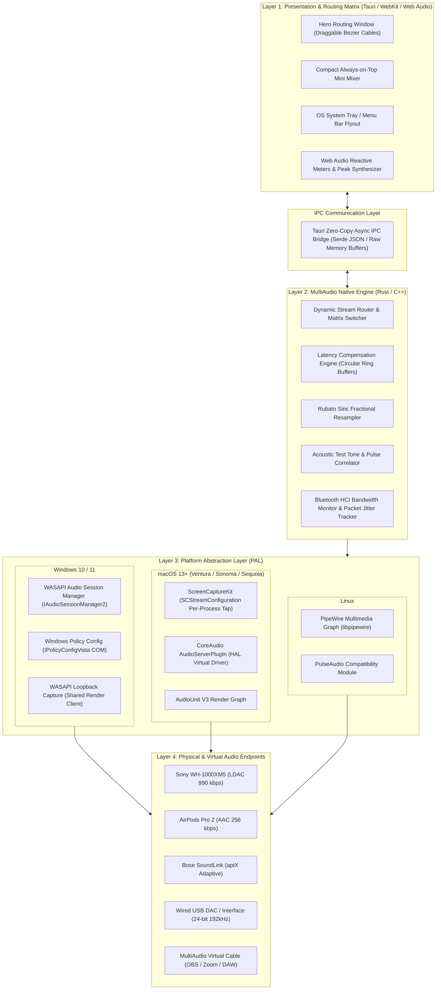

# MultiAudio — Technical Architecture Specification

MultiAudio is a minimalist per-app desktop audio router and latency synchronization mixer designed for Windows, macOS, and Linux. It allows simultaneous multi-stream routing (e.g., Spotify to Bluetooth headphones, browser/YouTube to desk speakers, and Discord to a separate headset) while eliminating Bluetooth latency drift and bandwidth bottlenecks.

---

## 1. High-Level Architecture Diagram

---

## 2. Core Subsystems

### 2.1 Presentation Layer (UI)
* **Design Philosophy:** Minimalist, single hero window with zero nested modal rabbit holes. Apps that produce sound appear as source nodes on the left; output sinks appear on the right.
* **Cable Patch Bay:** Interactive cubic Bezier patch cords (`M x1 y1 C ...`) with dynamic collision detection, snapping, and animated particle flow representing active audio power.
* **Window Adaptations:**
  1. **Hero Matrix Window:** Full drag-and-drop routing and calibration.
  2. **Always-On-Top Mini Mixer:** Pinned sleek floating widget displaying active faders and mute buttons.
  3. **System Tray / Menu Bar Popover:** Instant access to profiles, hotkeys, and master levels.

### 2.2 Native Audio Core (Rust Engine)
* **Real-Time Threading:** Audio processing occurs on high-priority OS multimedia threads (`AVRT` / `Pro Audio` priority on Windows, `THREAD_TIME_CONSTRAINT_POLICY` on macOS).
* **Memory Safety:** Lock-free Single-Producer Single-Consumer (SPSC) circular ring buffers between process audio capture and target endpoint feeds.
* **Overhead Target:** Internal processing latency < 2.5 ms, CPU utilization < 1% at 48kHz stereo.

---

## 3. Platform Audio Routing Mechanisms

| Feature | Windows 10/11 | macOS (13+) | Linux |
| :--- | :--- | :--- | :--- |
| **Per-App Routing** | Native via `IPolicyConfigVista` COM API | `ScreenCaptureKit` process tap | Native via PipeWire node ports (`pw-link`) |
| **Driver Required?** | **No** for 1-to-1 routing; bundled virtual driver for OBS loopback | **Yes** (AudioServerPlugIn HAL userland driver) | **No** (Direct PipeWire multimedia graph) |
| **Multi-Streaming (1-to-Many)** | WASAPI Loopback Capture Tap | HAL Plugin Splitter | PipeWire Node Splitting |
| **Sample Rate Handling** | Automatic WASAPI Shared Mixer Resampling | CoreAudio Converter AU | PipeWire Native Resampling (SPA) |

---

## 4. Latency Synchronization & Jitter Compensation

When routing the same audio stream (e.g., in **Silent Disco** mode) or gaming audio across different Bluetooth receivers, each receiver introduces variable internal buffer delays:
* **Sony WH-1000XM5 (LDAC):** ~135 ms
* **Apple AirPods Pro (AAC):** ~180 ms
* **Bose SoundLink (aptX):** ~95 ms
* **USB Wired Interface:** ~4 ms

### The MultiAudio Sync Algorithm:
1. **Clock Leader Selection:** The receiver with the highest round-trip latency is chosen as the **Synchronization Anchor** ($L_{max}$).
2. **Delay Compensation Line:** Every faster device is assigned an artificial delay buffer:
   $$\Delta D_i = L_{max} - L_i$$
3. **Drift Tracking:** Clock phase is continually estimated using a Kalman filter on Bluetooth HCI packet delivery timestamps to prevent buffer overruns without audible pitch distortion.
